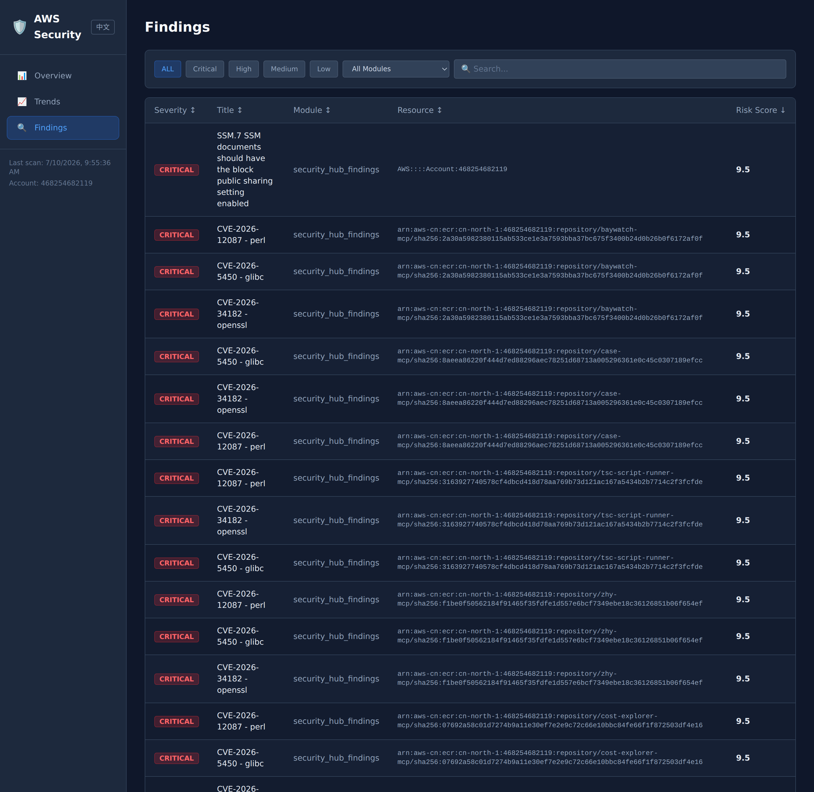
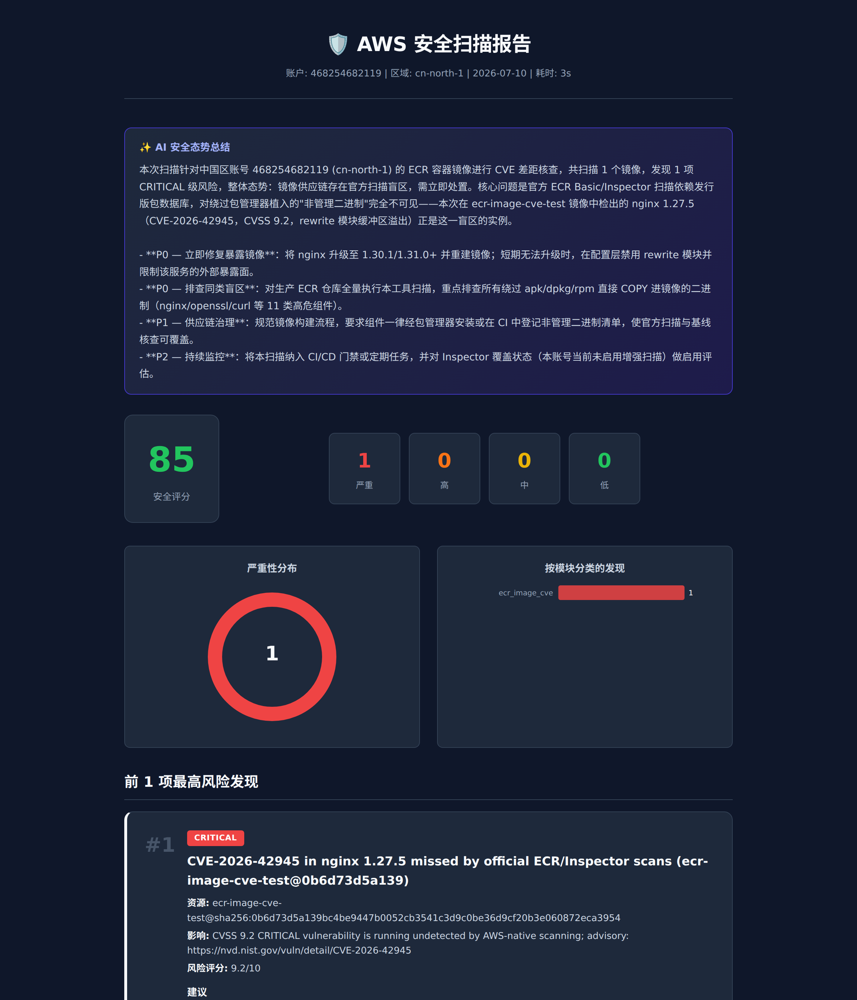
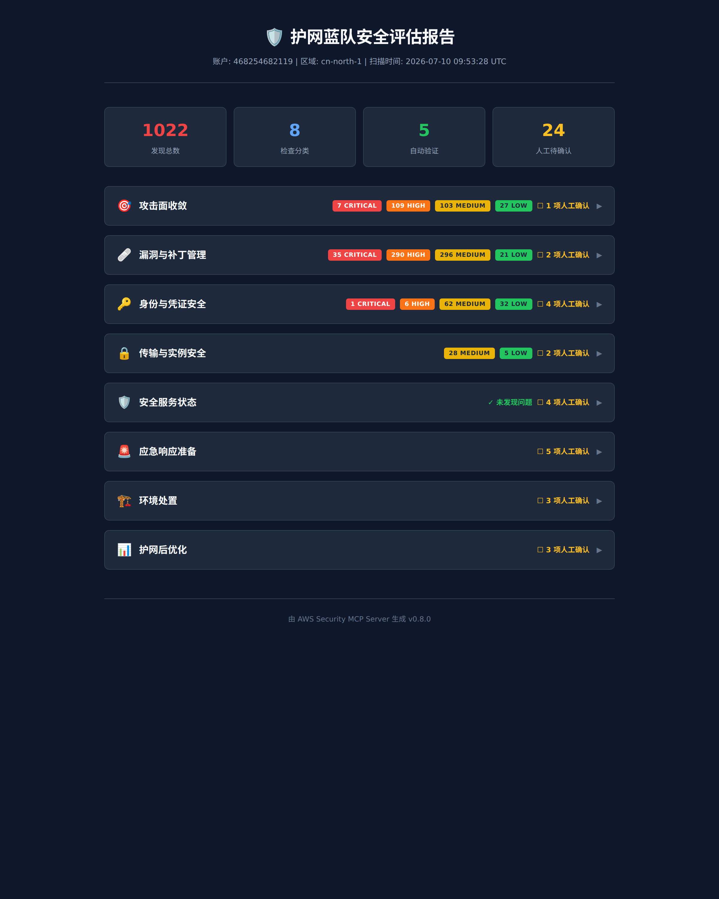
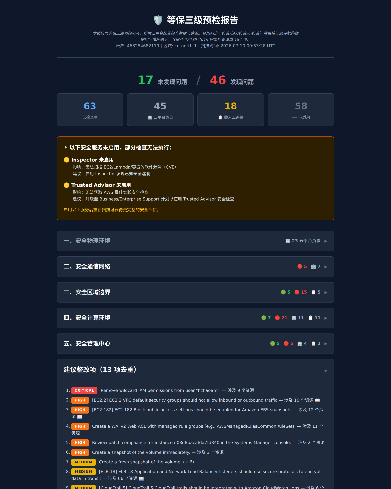
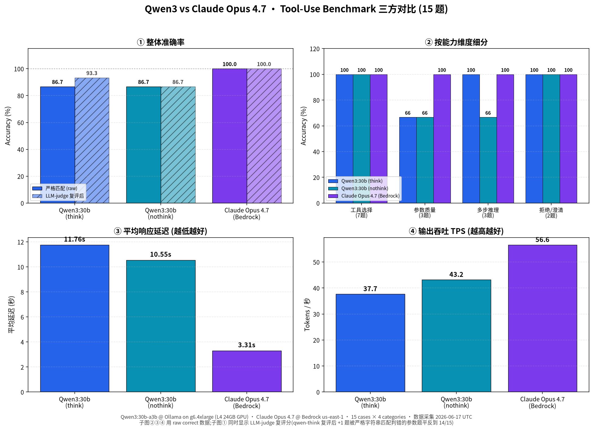
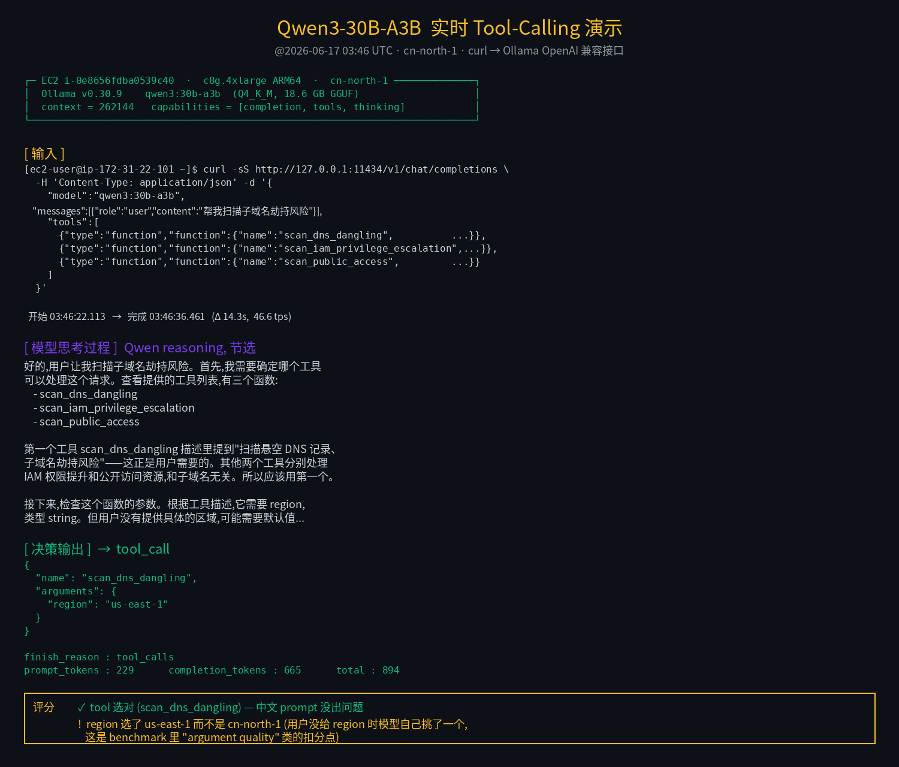

# aws-security-mcp

MCP server for automated AWS security scanning — 20 modules, risk scoring, zero write operations.

<!-- badges -->


## Features

- **20 Security Scan Modules** — Security Hub, GuardDuty, Inspector, Trusted Advisor, Config Rules, Access Analyzer, Patch Compliance, ECR image CVE gap analysis, and more
- **Risk Scoring** — every finding scored 0-10 with severity (CRITICAL/HIGH/MEDIUM/LOW) and priority (P0-P3)
- **CVE Exploitability Prioritization** — Inspector CVEs ranked P0-P3 by public exploit, EPSS, CISA KEV (offline snapshot) and configured network exposure, so the handful of actually exploitable vulnerabilities rise above thousands of CRITICAL/HIGH ones ([details](#cve-exploitability-prioritization))
- **100% Read-Only** — uses only Describe/Get/List API calls; never modifies your AWS resources
- **Multi-Account Support** — scan all accounts in an AWS Organization via `org_mode` with cross-account role assumption
- **Parallel Execution** — all modules run concurrently via `Promise.allSettled`
- **Report Generation** — Markdown, professional HTML, MLPS Level 3 compliance, and HW Defense reports
- **React Dashboard** — local or S3-hosted dashboard with 30-day trend charts
- **MCP Resources** — embedded security rules and risk scoring model documentation
- **MCP Prompts** — pre-built workflows for full scans and finding analysis
- **China Region Support** — full support for aws-cn partition
- **CloudFormation StackSet Template** — one-click deployment of cross-account audit roles

## Screenshots

All screenshots below are from a **real scan of an AWS China (cn-north-1) account** — 20 modules, 1,284 findings.

### Interactive Dashboard

React dashboard with severity filters, sortable columns, module breakdown, and 30-day trend charts. Findings view shown below (real CRITICAL CVEs detected across ECR repositories):



### Security Scan Report (with AI Executive Summary)

Professional HTML report. The server performs **zero LLM calls** — the calling AI supplies the executive summary via `get_ai_summary_prompt` → `ai_summary`, so the summary is tailored per report type:



### HW Defense (护网) Readiness Report

Attacker-perspective, SOP-organized report for blue-team hardening drills — findings grouped into kill-chain categories (attack-surface reduction, vuln/patch, identity, transport, detection readiness):



### MLPS Level 3 (等保三级) Compliance Pre-check

GB/T 22239-2019 conformance pre-check — technical findings mapped to compliance control domains, with service-not-enabled gaps and prioritized remediation:



## Deployment Prerequisites

Before installing, make sure you have the following in place. The agent is intentionally lightweight — **nothing needs to be installed on the AWS resources being scanned** (no agent on EC2, no daemon in VPC, no changes to workloads).

| # | Item | Purpose | Notes |
|---|------|---------|-------|
| 1 | **A host to run the MCP server** | Runs the Node.js process that performs the scans | Any of: a developer workstation (macOS / Linux / Windows), a small EC2 instance (t3.small is plenty), a bastion host, or a CI runner. Needs outbound HTTPS to AWS API endpoints. |
| 2 | **Node.js ≥ 18** | Runtime for the MCP server | `node --version` to verify |
| 3 | **An MCP-capable AI client** | Drives the scan via natural language and interprets the results | Any one of: **[Kiro CLI](https://kiro.dev)**, **[Claude Code](https://docs.anthropic.com/claude-code)**, **[Cursor](https://cursor.sh)**, or any other MCP 1.12-compatible client |
| 4 | **AWS credentials** | Read-only access to the target account(s) | IAM user, IAM role (EC2 instance profile / ECS task role), AWS SSO session, or named CLI profile — anything the AWS SDK credential chain can resolve |
| 5 | **An IAM identity with scan permissions** | Attached to the credential in (4) | Use [`SecurityAudit`](https://docs.aws.amazon.com/aws-managed-policy/latest/reference/SecurityAudit.html) managed policy, or the minimal custom policy in [Recommended IAM Policy](#recommended-iam-policy) below |
| 6 | *(optional)* **Cross-account audit role** | Needed only for multi-account / organization-wide scans | Deploy the CloudFormation StackSet template via `get_setup_template` — creates `AWSSecurityMCPAudit` in every member account in one shot |

**What is NOT required:**

- ❌ No agent / daemon on your EC2 instances, ECS tasks, or Lambda functions
- ❌ No changes to VPC, Security Groups, or networking on the scanned resources
- ❌ No AWS Marketplace subscription or commercial license
- ❌ No outbound connectivity from the scanner to anywhere other than AWS API endpoints (no telemetry, no phone-home)
- ❌ No AWS root user (the scanner refuses to run under root credentials)

### Reference deployment topology

The most common customer deployment is a **single small EC2 instance** in the AWS account to be audited, reached over SSM Session Manager or SSH, with the MCP client (Kiro / Claude Code / Cursor) running on the operator's laptop and the MCP server running on the EC2:

```
┌──────────────────────────┐          ┌─────────────────────────────┐
│  Operator's laptop       │          │  Target AWS account         │
│                          │          │                             │
│  Kiro CLI / Claude Code  │  MCP /   │  EC2 (t3.small, IAM role)   │
│  / Cursor                │  stdio   │  └─ aws-security-mcp        │
│                          │ ◄──────► │      (Node.js MCP server)   │
│                          │   SSM    │                             │
│                          │          │      ▼ read-only API calls  │
│                          │          │  IAM · EC2 · S3 · RDS · ... │
└──────────────────────────┘          └─────────────────────────────┘
```

For single-account work, running the MCP server **directly on the operator's laptop** (steps 1–3 below) is just as valid — the architecture is the same, only the host changes.

## Quick Start

### 1. Install

Install the published package from npm (recommended for end users):

```bash
npm install -g aws-security-mcp
```

Verify the binary is on your `PATH`:

```bash
aws-security-mcp --version
# 0.10.0
```

<details>
<summary>Installing from source (for contributors)</summary>

```bash
git clone https://github.com/jowhee327/aws-security-agent.git
cd aws-security-agent
npm install
npm run build
npm link   # makes `aws-security-mcp` resolvable on your PATH
```

</details>

### 2. Configure AWS Credentials

The server uses the standard AWS SDK credential chain. Any of the following will work:

```bash
# Environment variables
export AWS_ACCESS_KEY_ID=AKIA...
export AWS_SECRET_ACCESS_KEY=...
export AWS_REGION=ap-northeast-1

# Or use an AWS profile
export AWS_PROFILE=your-profile

# Or run on an EC2 instance / ECS task with an IAM role attached
```

See [Recommended IAM Policy](#recommended-iam-policy) below for the minimum permissions required.

### 3. Configure Your AI Tool

Add the MCP server to your AI tool's configuration:

#### Kiro

`.kiro/settings/mcp.json`:

```json
{
  "mcpServers": {
    "aws-security": {
      "command": "aws-security-mcp",
      "args": ["--region", "ap-northeast-1"]
    }
  }
}
```

#### Claude Code

`.claude/settings.json`:

```json
{
  "mcpServers": {
    "aws-security": {
      "command": "aws-security-mcp",
      "args": ["--region", "ap-northeast-1"]
    }
  }
}
```

#### Cursor

Add in Cursor MCP settings:

```json
{
  "mcpServers": {
    "aws-security": {
      "command": "aws-security-mcp",
      "args": ["--region", "ap-northeast-1"]
    }
  }
}
```

### 4. Use

Ask your AI tool to run a security scan. The recommended approach is `scan_and_report`, which runs all scanners and generates every report type in a single call — no large data transfer back to the AI tool:

> "Use scan_and_report to run a full AWS security scan"

Or run individual steps for more control:

> "Run a full AWS security scan and generate a report"

You can also use the built-in `security-scan` prompt for a guided workflow.

For multi-account scanning across an AWS Organization:

> "Run a full scan across all org accounts using org_mode"

### 5. Enable the Dashboard (optional)

The React dashboard visualizes scan history with severity filters, module breakdown, and 30-day trend charts. It reads data that the scan tools persist locally — no extra infrastructure needed.

**How dashboard data is produced**

Every time you run `scan_and_report` (or call `save_results` explicitly), the server writes:

```
~/.aws-security/
├── scans/YYYY-MM-DD/scan.json        # raw scan result archive (per day)
├── dashboard/data.json               # dashboard data: latest scan + rolling 30-entry history
└── reports/                          # HTML / MLPS3 / HW Defense / Markdown reports
```

`dashboard/data.json` keeps a rolling history (last 30 scan dates) with an overall security score per scan — this is what powers the trend charts. Same-day re-scans replace that day's entry instead of appending. An optional AI executive summary (via `get_ai_summary_prompt` → `ai_summary`) is persisted here too and rendered on the Overview page.

**Option A — local dashboard (recommended)**

```bash
aws-security-mcp dashboard --port 3000
```

This starts a local HTTP server, copies your `~/.aws-security/dashboard/data.json` into the dashboard bundle (falls back to bundled sample data if you haven't scanned yet), and opens `http://localhost:3000` in your browser. The npm package ships with the dashboard pre-built, so no build step is required.

**Option B — deploy to a private S3 bucket**

For a team-shared, long-lived dashboard inside your own AWS account:

```bash
aws-security-mcp deploy-dashboard --bucket <your-bucket> --region <region>
```

This uploads the dashboard files (including your latest `data.json`) to the bucket. The bucket **stays private** — no public bucket policy, no static website hosting is enabled. Access is controlled purely via IAM (e.g. S3 presigned URLs, CloudFront + OAC, or an internal proxy of your choice). Data never leaves your account.

**Installing from source?** Run `npm run build:dashboard` once before using either option (the npm-published package already includes `dashboard/dist`).

## Available Tools

| Tool | Description |
|------|-------------|
| `scan_all` | Run all 20 security scanners in parallel (supports org_mode) |
| `detect_services` | Detect enabled AWS security services and assess maturity |
| `scan_secret_exposure` | Check Lambda env vars and EC2 userData for exposed secrets |
| `scan_ssl_certificate` | Check ACM certificates for expiry and failed status |
| `scan_dns_dangling` | Detect dangling DNS records (subdomain takeover risk) |
| `scan_network_reachability` | Analyze true network reachability (SG + NACL rules) |
| `scan_iam_privilege_escalation` | Detect IAM privilege escalation paths |
| `scan_public_access_verify` | Verify actual public accessibility of resources |
| `scan_tag_compliance` | Check resources for required tags |
| `scan_idle_resources` | Find unused/idle resources |
| `scan_disaster_recovery` | Assess disaster recovery readiness |
| `scan_security_hub_findings` | Aggregate findings from AWS Security Hub |
| `scan_guardduty_findings` | Check if GuardDuty is enabled (findings via Security Hub) |
| `scan_inspector_findings` | Check Inspector enablement and pull active package-vulnerability findings directly from Inspector2, each with an exploitability assessment (falls back to detection-only + Security Hub when `inspector2:ListFindings` is unavailable) |
| `scan_trusted_advisor_findings` | Aggregate findings from AWS Trusted Advisor |
| `scan_config_rules_findings` | Check if Config is enabled (findings via Security Hub) |
| `scan_access_analyzer_findings` | Check if Access Analyzer is enabled (findings via Security Hub) |
| `scan_patch_compliance_findings` | Aggregate findings from SSM Patch Compliance |
| `scan_imdsv2_enforcement` | Check EC2 instances for IMDSv2 enforcement |
| `scan_waf_coverage` | Check internet-facing ALBs for WAF Web ACL protection |
| `prioritize_vulnerabilities` | "What do I fix first": CVE findings ordered by exploitability priority (P0 first) with funnel, rationale and reachability. Params: `priorities` (default `["P0","P1"]`), `limit` (default 20, max 200), `resource_type` (`ec2`/`ecr`/`lambda`), `include_reachability` (default true). AWS only (any non-aws `provider` returns an explicit error) |
| `scan_ecr_image_cve` | Deep-scan ECR image layers for critical/high CVEs missed by ECR Basic/Inspector Enhanced scanning; reports gap/confirmed/reverse-gap vs official results |
| `scan_group` | Run a predefined group of scanners for a specific scenario |
| `list_groups` | List available scan groups |
| `list_modules` | List available scan modules with descriptions |
| `list_org_accounts` | List all accounts in AWS Organization |
| `generate_report` | Generate a Markdown report from scan results |
| `generate_html_report` | Generate a professional HTML report |
| `generate_mlps3_report` | Generate a MLPS Level 3 compliance report |
| `generate_mlps3_html_report` | Generate a MLPS Level 3 HTML compliance report |
| `generate_hw_defense_report` | Generate an HW Defense HTML report (SOP-organized, findings grouped by CVE/control-ID) |
| `generate_maturity_report` | Generate a security maturity assessment |
| `scan_and_report` | Run full scan + generate all reports in one step. Saves HTML/MLPS/HW/MD reports to `~/.aws-security/reports/`. Avoids large data transfer |
| `save_results` | Save scan results for the dashboard |
| `get_setup_template` | Get CloudFormation StackSet template for cross-account audit role |

All tools accept an optional `region` parameter (defaults to the server's configured region). Scan tools also accept an optional `provider` parameter (`aws` by default, `huaweicloud`, or the experimental `alicloud` / `azure` — see [Multi-cloud](#multi-cloud-huawei-cloud-phase-1), [Alibaba Cloud](#multi-cloud-alibaba-cloud-experimental) and [Azure](#multi-cloud-azure-incl-azure-china--21vianet-experimental)).

## Recommended IAM Policy

Attach this policy to the IAM user or role running the scanner. All actions are read-only.

```json
{
  "Version": "2012-10-17",
  "Statement": [
    {
      "Sid": "SecurityScannerReadOnly",
      "Effect": "Allow",
      "Action": [
        "access-analyzer:ListAnalyzers",
        "access-analyzer:ListFindingsV2",

        "acm:DescribeCertificate",
        "acm:ListCertificates",

        "config:DescribeComplianceByConfigRule",
        "config:DescribeConfigurationRecorders",
        "config:GetComplianceDetailsByConfigRule",

        "elasticloadbalancing:DescribeLoadBalancers",

        "ec2:DescribeAddresses",
        "ec2:DescribeInstanceAttribute",
        "ec2:DescribeInstances",
        "ec2:DescribeNetworkAcls",
        "ec2:DescribeNetworkInterfaces",
        "ec2:DescribeSecurityGroups",
        "ec2:DescribeSnapshots",
        "ec2:DescribeSnapshotAttribute",
        "ec2:DescribeVolumes",
        "ec2:GetEbsEncryptionByDefault",

        "ecr:GetAuthorizationToken",
        "ecr:DescribeRepositories",
        "ecr:DescribeImages",
        "ecr:BatchGetImage",
        "ecr:GetDownloadUrlForLayer",
        "ecr:DescribeImageScanFindings",

        "ecs:ListClusters",
        "ecs:ListTasks",
        "ecs:DescribeTasks",
        "ecs:DescribeContainerInstances",

        "eks:ListClusters",

        "guardduty:GetDetector",
        "guardduty:ListDetectors",
        "guardduty:ListFindings",
        "guardduty:GetFindings",

        "iam:GetAccountSummary",
        "iam:ListUsers",
        "iam:ListRoles",
        "iam:ListAccessKeys",
        "iam:GetAccessKeyLastUsed",
        "iam:ListAttachedUserPolicies",
        "iam:ListAttachedRolePolicies",
        "iam:ListUserPolicies",
        "iam:ListRolePolicies",
        "iam:GetUserPolicy",
        "iam:GetRolePolicy",
        "iam:GetPolicy",
        "iam:GetPolicyVersion",

        "inspector2:BatchGetAccountStatus",
        "inspector2:ListFindings",
        "inspector2:ListCoverage",

        "lambda:ListFunctions",
        "lambda:GetFunction",
        "lambda:GetFunctionUrlConfig",

        "organizations:ListAccounts",

        "rds:DescribeDBInstances",

        "route53:ListHostedZones",
        "route53:ListResourceRecordSets",

        "s3:GetBucketAcl",
        "s3:GetBucketLocation",
        "s3:GetBucketPolicyStatus",
        "s3:GetBucketPublicAccessBlock",
        "s3:GetBucketVersioning",
        "s3:GetBucketReplication",
        "s3:GetBucketTagging",
        "s3:ListAllMyBuckets",

        "securityhub:DescribeHub",
        "securityhub:GetFindings",

        "ssm:DescribeInstanceInformation",
        "ssm:DescribeInstancePatchStates",

        "sts:GetCallerIdentity",

        "support:DescribeTrustedAdvisorChecks",
        "support:DescribeTrustedAdvisorCheckResult",

        "wafv2:GetWebACL",
        "wafv2:GetWebACLForResource"
      ],
      "Resource": "*"
    }
  ]
}
```

## Scan Modules

| Module | What It Checks | Risk Score Range |
|--------|---------------|-----------------|
| **Service Detection** | Enabled security services (Security Hub, GuardDuty, Inspector, Config, CloudTrail) and maturity level | 5.0 - 7.5 |
| **Secret Exposure** | Lambda env vars and EC2 userData for exposed secrets (AWS keys, private keys, passwords) | 7.0 - 9.5 |
| **SSL Certificate** | ACM certificate expiry, failed status, upcoming renewals | 5.5 - 9.0 |
| **Dangling DNS** | Route53 CNAME records pointing to non-existent resources (subdomain takeover) | 7.0 - 8.5 |
| **Network Reachability** | True network reachability combining Security Group + NACL rules for public EC2 instances | 5.5 - 9.5 |
| **IAM Privilege Escalation** | Privilege escalation paths via policy manipulation, role creation, or service abuse | 7.0 - 9.5 |
| **Public Access Verify** | Actual public accessibility of resources marked as public (S3 HTTP, RDS DNS) | 7.0 - 9.0 |
| **Tag Compliance** | Required tags (Environment, Project, Owner) on EC2, RDS, S3 resources | 3.0 - 5.0 |
| **Idle Resources** | Unused resources (unattached EBS, unused EIPs, stopped instances, unused SGs) | 3.0 - 5.0 |
| **Disaster Recovery** | RDS Multi-AZ & backups, EBS snapshot coverage, S3 versioning & replication | 4.0 - 7.5 |
| **Config Rules** | AWS Config Rules compliance status | 3.0 - 9.5 |
| **Access Analyzer** | IAM Access Analyzer external access findings | 3.0 - 9.5 |
| **Patch Compliance** | SSM Patch Manager compliance status for managed instances | 3.0 - 9.5 |
| **IMDSv2 Enforcement** | EC2 instances not enforcing IMDSv2 (HttpTokens != required) | 7.5 |
| **WAF Coverage** | Internet-facing ALBs without WAF Web ACL protection | 7.5 |
| **ECR Image CVE** | Deep layer scan of ECR images for critical/high CVEs that ECR Basic/Inspector Enhanced scanning structurally miss (unmanaged binaries, distro secdb gaps, EOL OS); diffs against official scan results | 7.0 - 10.0 |
| **Security Hub Findings** | AWS Security Hub (FSBP, CIS, PCI DSS) | 3.0 - 9.5 |
| **GuardDuty Findings** | Amazon GuardDuty threat detection | 3.0 - 9.5 |
| **Inspector Findings** | Amazon Inspector package vulnerabilities pulled directly from Inspector2, ranked by [exploitability](#cve-exploitability-prioritization) | 0.1 - 10.0 (banded by exploitability priority) |
| **Trusted Advisor Findings** | AWS Trusted Advisor security checks (requires Business/Enterprise Support) | 5.5 - 8.0 |

### Risk Scoring

| Score | Severity | Priority |
|-------|----------|----------|
| 9.0 - 10.0 | CRITICAL | P0 |
| 7.0 - 8.9 | HIGH | P1 |
| 4.0 - 6.9 | MEDIUM | P2 |
| 0.0 - 3.9 | LOW | P3 |

## How the ECR Image CVE Scanner Works (Scanner #20)

The newest module, `ecr-image-cve`, exists because of a real customer case: an ECR image (`Alpine 3.21 + nginx 1.27`) contained a HIGH-severity nginx CVE, yet **both ECR Basic Scanning and Inspector Enhanced Scanning reported nothing**. Distro-feed-based scanners can only alert on what the distro security database lists, and package-metadata matching misses any binary that didn't come from the distro's package manager (edge/community packages, vendor repos, source-compiled binaries). This scanner is built to catch exactly those structural blind spots — and to report the **difference (gap)** against the official scan results rather than duplicating them.

**Pipeline (no Docker daemon, all read-only, fully streaming):**

1. **Image enumeration** — `DescribeRepositories` / `DescribeImages`, taking the latest-pushed 3 tags per repo plus any `latest` tag (configurable). Image **digest** is the identity key everywhere, since tags drift.
2. **Layer acquisition over the ECR registry HTTP API** — authenticate with `GetAuthorizationToken`, fetch the manifest via `BatchGetImage`, and download layer blobs via `GetDownloadUrlForLayer`. Multi-arch manifest lists are handled (linux/amd64 preferred, then linux/arm64). Layers are stream-decompressed (gzip + tar) entry-by-entry — no full-layer buffering, no image is ever run. Size guards: 512 MB per layer / 2 GB per image / 50 repos / 20 GB per scan (all configurable); anything over-limit is recorded as `skipped` with the reason, never silently dropped.
3. **Dual-channel component inventory** — the core idea:
   - **Channel A (package level):** parse package-manager databases found inside layers — Alpine `/lib/apk/db/installed` and Debian/Ubuntu `/var/lib/dpkg/status` — plus `/etc/os-release` for the distro branch. This mirrors what official scanners see.
   - **Channel B (binary level, what ECR cannot do):** detect well-known server binaries (nginx, openssl, curl, redis, node, httpd, haproxy, php, python3, java, envoy) via ELF-magic + path heuristics, then extract embedded version strings from the raw bytes with signature regexes (e.g. `nginx version: nginx/1.27.4`). Each hit is tagged with provenance: `package-managed` (explainable by Channel A) or **`unmanaged-binary`** (present in the image but not owned by any installed package — the blind-spot case, prominently flagged).
4. **CVE matching (CRITICAL/HIGH only)** — two tiers:
   - **Tier 1 (offline, default):** a curated, unit-tested advisory table bundled with the package, covering the Channel-B component list. Works fully air-gapped — important for China-region deployments.
   - **Tier 2 (online, opt-in):** NVD API 2.0 lookups with 24h on-disk caching, gated by `onlineCveLookup` (default off).
   - Version comparison normalizes non-semver forms (Alpine `-r0` package revisions, OpenSSL letter suffixes like `1.0.2k`) while preserving the original string in output.
5. **Official-result diff (gap analysis)** — for every scanned image the scanner pulls official findings from `ecr:DescribeImageScanFindings` (Basic) and `inspector2:ListFindings` (Enhanced), then classifies each of its own findings as:
   - **`gap`** — we found it, official scanning did not → the headline section, each with a machine-classified reason: `unmanaged-binary` | `distro-secdb-no-entry` | `eol-os` | `unsupported-os` | `unknown`;
   - **`confirmed`** — both found it (collapsed to counts);
   - **`reverse-gap`** — official found it, we did not (self-audit).
   The report also records which official baseline was available per image (basic / enhanced / none).
6. **False-positive control** — a `suppressions` parameter (`cveId` + optional digest prefix / component + reason) moves findings to a `suppressed[]` section instead of silently dropping them.

Additional IAM permissions used (read-only): `ecr:GetAuthorizationToken`, `ecr:DescribeRepositories`, `ecr:DescribeImages`, `ecr:BatchGetImage`, `ecr:GetDownloadUrlForLayer`, `ecr:DescribeImageScanFindings`, `inspector2:ListFindings`, `inspector2:ListCoverage` — already included in the [Recommended IAM Policy](#recommended-iam-policy).

Invoke it directly via `scan_ecr_image_cve`, as part of the `container_security` group, or within `scan_all` / `scan_and_report`. Full design notes: [`docs/specs/ecr-image-cve-scanner-spec.md`](docs/specs/ecr-image-cve-scanner-spec.md).

## CVE Exploitability Prioritization

> **Positioning.** This is **exploitability prioritization based on threat intelligence (exploit availability, EPSS, CISA KEV) and exposure (public IP, security groups, NACLs, running state)**. It is **not penetration testing or vulnerability verification**. The tool is read-only end to end and performs no active probing of any resource (no packets sent, no port scans, no connections to target IPs). `internet_open` means the *configuration* allows access from anywhere; it does not prove the vulnerability is exploitable.

Sorting CVEs by CVSS alone buries the few that matter: a typical account has hundreds of CRITICAL and thousands of HIGH findings. Each Inspector CVE finding now carries an `exploitability` object and is ranked P0–P3 from four signal layers:

| Layer | Signal | Source |
|---|---|---|
| L1 | Public exploit available | Inspector `exploitAvailable` / ASFF `Vulnerabilities[].ExploitAvailable` |
| L2 | Exploit probability (EPSS) | `epss.score` — high ≥ 0.1, medium ≥ 0.01 |
| L3 | Exploited in the wild | CISA KEV catalog, bundled offline snapshot |
| L4 | Reachability | EC2 public IP + SG + NACL; ECR image → running ECS task ENI; Lambda Function URL |

Priority rules (first match wins; every result carries a machine-readable `rationaleCode` and an English `rationale`):

| # | Condition | Priority | `rationaleCode` |
|---|---|---|---|
| 1 | In KEV and `internet_open` | **P0** | `KEV_INTERNET` |
| 2 | Public exploit and `internet_open` | **P0** | `EXPLOIT_INTERNET` |
| 3 | EPSS high and `internet_open` | **P0** | `EPSS_HIGH_INTERNET` |
| 4 | In KEV, not `internet_open` (`not_running` → `KEV_NOT_RUNNING`, must fix before redeploying; `allowlist` / `internal` / `unknown` → `KEV_NOT_EXPOSED`) | P1 | `KEV_NOT_RUNNING` / `KEV_NOT_EXPOSED` |
| 5 | Public exploit and EPSS high | P1 | `EXPLOIT_EPSS_HIGH` |
| 6 | Public exploit and `allowlist` | P1 | `EXPLOIT_ALLOWLIST` |
| 7 | Public exploit (no internet exposure) | P2 | `EXPLOIT_LIMITED` |
| 8 | EPSS high | P2 | `EPSS_HIGH` |
| 9 | EPSS medium | P2 | `EPSS_MEDIUM` |
| 10 | Everything else | P3 | `BASELINE` |

Reachability values: `internet_open` (public address and an SG rule from `0.0.0.0/0` / `::/0` that the subnet NACL also allows), `allowlist` (public address, but only specific public CIDRs / prefix lists — a `/32` allow-list is never `internet_open`), `internal`, `not_running` (ECR image not observed in a running ECS task), `unknown` (not evaluated — never escalated to P0). P0 always requires `internet_open`; `allowlist` does not count as internet-reachable.

**Backward compatibility.** `Finding.severity` and the severity-derived `Finding.priority` are unchanged; the exploitability priority lives in `exploitability.priority`. `riskScore` is re-banded so that sorting by `riskScore` equals sorting by exploitability priority (P0 9.0–10.0, P1 7.0–8.9, P2 4.0–6.9, P3 0.1–3.9, order within a band preserved; the original score is kept in `exploitability.originalRiskScore`). A CRITICAL CVE with no exploit signal therefore keeps its CRITICAL badge but ranks after P0/P1. Findings without a CVE are byte-for-byte unchanged.

**Data source & de-duplication.** `inspector_findings` pulls `ListFindings` (ACTIVE, PACKAGE_VULNERABILITY) directly — partitioned by resource type, 3 streams in parallel, capped at 20,000 findings with exploit/EPSS findings always kept. In `scan_all` / `scan_group` the Security Hub copies of the same Inspector findings are removed (by finding ARN, then CVE + resource), with a `Deduplicated N Inspector findings…` warning. If Inspector2 cannot be read, the scanner falls back to detection-only and the Security Hub Inspector CVEs get the same assessment from their ASFF signals.

**Where it shows up.** HTML report (Top 5 by exploitability priority, "🎯 Exploitability Assessment" block with funnel + P0/P1 table + KEV snapshot date; the Inspector module renders at most 200 cards plus a per-CVE summary table), HW Defense report (P0/P1 first under "Vulnerability & Patch Management"), Markdown report, AI summary prompt, dashboard (exploitability card, priority column), and the `prioritize_vulnerabilities` tool.

### `prioritize_vulnerabilities`

```text
prioritize_vulnerabilities { "region": "cn-north-1", "priorities": ["P0", "P1"], "limit": 20 }
```

Returns a short summary plus JSON:

```text
{
  "dataSource": "inspector2",
  "funnel": { "total": {...}, "exploitAvailable": {...}, "epssHigh": {...}, "kev": {...}, "reachable": {...}, "p0": {...}, "byPriority": {...} },
  "kevSnapshotDate": "2026-11-03",
  "disclaimer": "This is exploitability prioritization ... NOT penetration testing ...",
  "matched": 132,
  "items": [
    { "cveId": "CVE-YYYY-NNNNN", "priority": "P0", "rationaleCode": "KEV_INTERNET", "rationale": "In CISA KEV ...",
      "resourceType": "AwsEc2Instance", "resourceId": "i-0123456789abcdef0", "severity": "HIGH",
      "exploitAvailable": true, "epss": 0.42, "kev": true, "reachability": "internet_open", "fixAvailable": "YES" }
  ],
  "truncated": true
}
```

`include_reachability: false` skips L4 (all `unknown`) for a faster answer.

### Example (real account, cn-north-1, read-only)

| Layer | Findings |
|---|---|
| Inspector2 direct pull | 9,914 findings / 6,671 CVEs |
| Public exploit | 1,311 |
| EPSS high (≥ 0.1) | 38 |
| CISA KEV | 29 |
| Reachable (`internet_open` + `allowlist`) | 888 |
| **P0 / P1 / P2 / P3** | **9 / 123 / 1,449 / 8,333** |
| Security Hub Inspector duplicates removed | 9,888 |

The two public EC2 instances (SGs with `/32` allow-list rules only) were classified `allowlist`; the 5 running ECS Fargate images were `internal` (public IP on the ENI, but the SG only admits the VPC CIDR and SG references). Instead of thousands of CRITICAL/HIGH findings, the "fix first" list is 9 P0 + 123 P1.

### IAM permissions

New read-only actions (already in the [Recommended IAM Policy](#recommended-iam-policy)): `inspector2:BatchGetAccountStatus`, `inspector2:ListFindings`, `ecs:ListClusters`, `ecs:ListTasks`, `ecs:DescribeTasks`, `ecs:DescribeContainerInstances`, `ec2:DescribeNetworkInterfaces`, `eks:ListClusters`, `lambda:GetFunctionUrlConfig` (plus the existing `ec2:DescribeInstances`, `ec2:DescribeSecurityGroups`, `ec2:DescribeNetworkAcls`). All are List/Describe/Get; verified on 2026-11-04 to be included in both AWS managed policies **SecurityAudit** (v92) and **ReadOnlyAccess** (v187) in the `aws-cn` partition. Missing permissions degrade gracefully (reachability `unknown` + one warning; no module error).

### CISA KEV snapshot

The KEV catalog ships offline at `src/data/kev.json` (CISA KEV is a U.S. Government work in the public domain; source <https://www.cisa.gov/known-exploited-vulnerabilities-catalog>). Scans make **no** network call for KEV by default. Reports show the snapshot date and warn when it is older than 90 days. To update:

```bash
npx tsx scripts/update-kev.ts                    # download the official feed
npx tsx scripts/update-kev.ts --from feed.json   # or use a locally downloaded copy
```

Setting `AWS_SECURITY_MCP_KEV_REFRESH=1` makes the server try an in-memory refresh at scan time (5 s timeout; on failure it silently keeps the offline snapshot and adds a warning; it never writes files).

### Known limitations

- Reachability is configuration-based (public IP, SG, NACL). Load balancer / CloudFront fronting and route tables / IGW are **not** evaluated.
- **EKS is not evaluated**: if the account has EKS clusters, images not seen in ECS are `unknown` instead of `not_running`.
- ECS running state is a **point-in-time snapshot** taken during the scan.
- **Lambda Function URL is not supported in China regions** — `GetFunctionUrlConfig` is rejected there, so Lambda reachability is `unknown` (one warning). API Gateway / ALB triggers are not evaluated.
- In org mode, reachability of **member-account resources is `unknown`** (only the scanning account's resources are resolved).
- Only the AWS provider is covered; Huawei Cloud results carry no exploitability data.

## Scan Groups

Pre-defined scanner groupings for common scenarios:

| Group | Description | Modules |
|-------|-------------|---------|
| `mlps3_precheck` | GB/T 22239-2019 等保三级预检 | 17 modules |
| `hw_defense` | 护网蓝队加固 — attacker-focused hardening | 11 modules |
| `exposure` | 公网暴露面评估 | 8 modules |
| `data_encryption` | 数据加密审计 | 2 modules |
| `least_privilege` | 最小权限审计 | 3 modules |
| `log_integrity` | 日志完整性审计 | 2 modules |
| `disaster_recovery` | 灾备评估 | 2 modules |
| `idle_resources` | 闲置资源清理 | 2 modules |
| `tag_compliance` | 资源标签合规 | 1 module |
| `new_account_baseline` | 新账户基线检查 | 7 modules |
| `container_security` | 容器/工作负载安全 — ECR image deep CVE scan + official-scan gap analysis | 3 modules |
| `aggregation` | 安全服务聚合 | 7 modules |

Use `list_groups` to see all available groups with their module lists.

## Multi-Account Support

For scanning across an AWS Organization:

1. **Deploy the audit role** — Use `get_setup_template` to retrieve the CloudFormation StackSet template, then deploy it from your Management Account to create the `AWSSecurityMCPAudit` role in all member accounts.

2. **Run with org_mode** — Pass `org_mode: true` to `scan_all` or `scan_group`. The scanner will discover accounts via `organizations:ListAccounts` and assume the audit role in each.

3. **Optional filtering** — Pass `account_ids` to scan specific accounts instead of the full organization.

The StackSet templates are available in the `templates/` directory in both YAML and JSON formats.

## Supported clouds

| Provider (`provider`) | Status | Modules | Validation |
|-----------------------|--------|---------|------------|
| AWS (`aws`, default) | stable | 20 | production |
| Huawei Cloud (`huaweicloud`) | Phase 1 | 11 | see [Huawei Cloud](#multi-cloud-huawei-cloud-phase-1) |
| Alibaba Cloud (`alicloud`) | **experimental** | 14 | mock-tested only, **not live-validated** — see [Alibaba Cloud](#multi-cloud-alibaba-cloud-experimental) |
| Azure (`azure`, Azure China / 21Vianet default, Global supported) | **experimental** | 12 | mock-tested only, **not live-validated** — see [Azure](#multi-cloud-azure-incl-azure-china--21vianet-experimental) |

## Multi-cloud (Huawei Cloud, Phase 1)

The server can scan a **Huawei Cloud** account with the same tools and report formats. AWS remains the default; nothing changes unless you pass `provider`.

**Selecting the provider**

- Every scan tool (`scan_all`, `scan_group`, `scan_<module>`, `scan_and_report`, `detect_services`, `list_modules`, `list_org_accounts`) accepts an optional `provider: "aws" | "huaweicloud"` parameter (default `aws`).
- Server-wide default: `aws-security-mcp --provider huaweicloud`, or the environment variable `CLOUD_PROVIDER=huaweicloud` (alias `AWS_SECURITY_MCP_PROVIDER`).
- Region semantics with `provider: "huaweicloud"`: `region` is a Huawei Cloud region ID (e.g. `cn-north-4`). Omit it, or pass `"all"`, to scan every region project of the account (discovered via IAM `keystoneListProjects`). Account-wide modules (RMS) run once; regional modules run once per region.

**Credentials** (read-only access key pair; the SDK does not read the file itself, the server parses it)

1. Environment: `HUAWEICLOUD_SDK_AK` / `HUAWEICLOUD_SDK_SK` (optional `HUAWEICLOUD_SDK_SECURITY_TOKEN`, `HUAWEICLOUD_SDK_PROJECT_ID`, `HUAWEICLOUD_SDK_DOMAIN_ID`).
2. File: `~/.huaweicloud/credentials` (override with `HUAWEICLOUD_CREDENTIALS_FILE`) with an INI layout:

```ini
[basic]
ak = <access key for regional services>
sk = <secret key>

[global]
ak = <access key for global services: IAM / RMS / Organizations>
sk = <secret key>
```

Project IDs (per region) and the domain ID are resolved once via IAM and cached. Credential values are never logged; the Huawei SDK's built-in log4js output is disabled because it would otherwise print signed `Authorization` headers to stdout (the MCP transport).

**Supported modules (11)**

| Module | Huawei Cloud services | Notes |
|--------|-----------------------|-------|
| `service_detection` | CTS, RMS (Config), HSS, SecMaster | Security-service maturity matrix |
| `config_rules_findings` | RMS tracker | Detection only (recorder enabled?) |
| `rms_compliance_findings` | RMS policy states | Huawei-only aggregation module; substitutes `security_hub_findings` in scan groups and reports (`scan_rms_compliance_findings`) |
| `public_access_verify` | OBS (ACL / bucket policy / public access block), RDS public IPs | |
| `secret_exposure` | FunctionGraph env vars, ECS user data | |
| `ssl_certificate` | SCM, ELB certificates | |
| `idle_resources` | EVS, EIP, ECS, VPC security groups | |
| `tag_compliance` | RMS resource inventory | Required tags: Environment / Project / Owner |
| `inspector_findings` | HSS host vulnerabilities | Detection + summary: no protected hosts → "HSS not enabled" finding; otherwise unhandled Critical/High vulnerabilities as findings (top 50), Medium/Low summarised in a warning |
| `patch_compliance_findings` | HSS per-host OS vulnerabilities (`linux_vul` / `windows_vul`) | Huawei Cloud has no Patch Manager; one finding per protected host with unhandled OS vulnerabilities (Critical/High → 7.5, else 5.5) |
| `imdsv2_enforcement` | ECS metadata options (`http_tokens`) | Per-server `showMetadataOptions` (running servers, concurrency 5, cap 500); `http_tokens != required` → 7.5 |

Findings use the URN `hws:<region>:<domainId>:<service>:<type>:<id>` in `resourceArn`; `accountId` is the IAM domain ID. Report generators (Markdown / HTML / MLPS Level 3 / HW Defense) accept Huawei results; MLPS "cloud provider" items are worded for Huawei Cloud and Security Hub control IDs are replaced by RMS built-in policy names where mapped (e.g. `iam-user-mfa-enabled`, `volumes-encrypted-check`, `vpc-sg-ports-check`).

**Recommended read-only IAM system policies** (attach to the audit user / agency)

`IAM ReadOnlyAccess`, `RMS ReadOnlyAccess`, `CTS ReadOnlyAccess`, `OBS ReadOnlyAccess` (or `Tenant Guest`), `ECS ReadOnlyAccess`, `EVS ReadOnlyAccess`, `VPC ReadOnlyAccess` (includes EIP), `RDS ReadOnlyAccess`, `ELB ReadOnlyAccess`, `SCM Administrator` (no dedicated read-only policy), `FunctionGraph ReadOnlyAccess`, `HSS ReadOnlyAccess`, `SecMaster ReadOnlyAccess`; for later phases also `WAF ReadOnlyAccess`, `DNS ReadOnlyAccess`, `CBR ReadOnlyAccess`, `CES ReadOnlyAccess`, `Organizations ReadOnlyAccess`. `Tenant Guest` covers most reads but **not** IAM security-policy reads. Missing permissions degrade gracefully: the module reports a warning and stays `success`.

**Known limitations (Phase 1)**

- Single account only. `org_mode` / `role_name` emit a warning and scan the current account; multi-account via Organizations + STS `assumeAgency` is reserved for Phase 2 (`list_org_accounts` returns an error for `huaweicloud`).
- No IAM privilege-escalation scanner yet (requires `IAM ReadOnlyAccess`, which the reference test account lacks); `dns_dangling`, `network_reachability`, `disaster_recovery`, `waf_coverage`, `guardduty_findings`, `trusted_advisor_findings`, `access_analyzer_findings` and `scan_ecr_image_cve` are AWS-only for now (requesting them with `provider: "huaweicloud"` returns a clear error; scan groups list them as unavailable).
- No enterprise-project (EPS) splitting; results cover the whole account.

## Multi-cloud (Alibaba Cloud, experimental)

> **EXPERIMENTAL.** The Alibaba Cloud provider is mock-tested only — it has **not yet been validated against a live Alibaba Cloud account**. API field names follow the official API docs; expect rough edges until live validation.

The same tools and report formats work against an **Alibaba Cloud** (阿里云) account. AWS remains the default; nothing changes unless you pass `provider`.

**Selecting the provider**

- Every scan tool accepts `provider: "alicloud"` (same tool list as Huawei Cloud above). Server-wide default: `CLOUD_PROVIDER=alicloud`.
- Region semantics with `provider: "alicloud"`: `region` is an Alibaba Cloud region ID (e.g. `cn-hangzhou`). Omit it, or pass `"all"`, to scan every region (discovered via ECS `DescribeRegions`). Account-wide modules (RAM, Config, Security Center, CAS) run once; regional modules run once per region.
- Site: `ALIBABA_CLOUD_SITE=cn` (default, China site) or `intl` (international site). It selects the centralised endpoints (Config `config.cn-shanghai` vs `config.ap-southeast-1`, Security Center `tds` vs `tds.ap-southeast-1`).

**Credentials** (read-only AccessKey; the server parses them itself and never probes the ECS metadata service)

1. Environment: `ALIBABA_CLOUD_ACCESS_KEY_ID` / `ALIBABA_CLOUD_ACCESS_KEY_SECRET` (optional `ALIBABA_CLOUD_SECURITY_TOKEN` for STS credentials).
2. File: `~/.alibabacloud/credentials` (override with `ALIBABA_CLOUD_CREDENTIALS_FILE`), profile `ALIBABA_CLOUD_PROFILE` (default `default`):

```ini
[default]
type = access_key            ; or sts (+ security_token)
access_key_id = <access key id>
access_key_secret = <access key secret>
```

The account ID (UID) is resolved via STS `GetCallerIdentity`. Credential values are never logged, and error text is redacted (Alibaba Cloud error responses can echo the AccessKey ID). An invalid AccessKey is reported as `Alibaba Cloud authentication failed` (module status `error`), never as "service not enabled".

**Recommended RAM permissions** (attach to the audit RAM user / role)

Simplest: the system policy `ReadOnlyAccess`. Fine-grained alternative: `AliyunRAMReadOnlyAccess`, `AliyunConfigReadOnlyAccess`, `AliyunActionTrailReadOnlyAccess`, `AliyunECSReadOnlyAccess` (`ecs:DescribeUserData` may need an explicit grant), `AliyunVPCReadOnlyAccess`, `AliyunSLBReadOnlyAccess`, `AliyunRDSReadOnlyAccess`, `AliyunOSSReadOnlyAccess`, `AliyunYundunSASReadOnlyAccess`, `AliyunYundunWAFReadOnlyAccess`, `AliyunYundunCertReadOnlyAccess`, `AliyunKMSReadOnlyAccess`, `AliyunFCReadOnlyAccess`. Policy names are still to be confirmed on a live account. Missing permissions degrade per sub-service: the module reports a warning and stays `success`.

**Module maturity (14)** — all modules: *experimental — mock-tested only, NOT validated against a live account*

| Module | Alibaba Cloud services | Maturity |
|--------|------------------------|----------|
| `service_detection` | ActionTrail, Config, Security Center (SAS), WAF 3.0, KMS | experimental — mock-tested only, NOT validated against a live account |
| `config_rules_findings` | Config resource recorder | experimental — mock-tested only, NOT validated against a live account |
| `config_compliance_findings` | Config rules / compliance packs (NON_COMPLIANT evaluations) — substitutes `security_hub_findings` (`scan_config_compliance_findings`) | experimental — mock-tested only, NOT validated against a live account |
| `public_access_verify` | OSS (ACL / bucket policy / Block Public Access), RDS public endpoints + IP whitelist | experimental — mock-tested only, NOT validated against a live account |
| `secret_exposure` | ECS user data, Function Compute 3.0 env vars | experimental — mock-tested only, NOT validated against a live account |
| `ssl_certificate` | Certificate Management Service (CAS) | experimental — mock-tested only, NOT validated against a live account |
| `imdsv2_enforcement` | ECS metadata options (hardened mode, `HttpTokens`) | experimental — mock-tested only, NOT validated against a live account |
| `idle_resources` | ECS disks / stopped instances / security groups, VPC EIPs | experimental — mock-tested only, NOT validated against a live account |
| `tag_compliance` | ECS, SLB, RDS, OSS tags | experimental — mock-tested only, NOT validated against a live account |
| `network_reachability` | ECS public instances + security group ingress rules | experimental — mock-tested only, NOT validated against a live account |
| `iam_privilege_escalation` | RAM users / groups / roles / policies, IMS (root AccessKey, MFA, password policy) | experimental — mock-tested only, NOT validated against a live account |
| `guardduty_findings` | Security Center (SAS) alerts | experimental — mock-tested only, NOT validated against a live account |
| `inspector_findings` | Security Center (SAS) vulnerabilities (cve / app / emg) | experimental — mock-tested only, NOT validated against a live account |
| `patch_compliance_findings` | Security Center (SAS) OS vulnerabilities per host | experimental — mock-tested only, NOT validated against a live account |

Findings use Alibaba Cloud ARNs `acs:<service>:<region>:<uid>:<type>/<id>` (global services leave the region empty, e.g. `acs:ram::<uid>:user/<name>`) in `resourceArn`. Report generators (Markdown / HTML / MLPS Level 3 / HW Defense) accept Alibaba Cloud results; MLPS "cloud provider" items are worded for Alibaba Cloud and Security Hub control IDs are mapped to Config managed-rule identifiers where known (e.g. `ram-user-mfa-check`, `actiontrail-enabled`, `sg-public-access-check` — identifiers still to be confirmed with a live `ListManagedRules`).

**Known limitations (experimental phase)**

- Single account only. `org_mode` / `role_name` emit a warning and scan the current account; multi-account via Resource Directory + STS `AssumeRole` is reserved for a later phase.
- `dns_dangling`, `disaster_recovery`, `waf_coverage` are deferred; `trusted_advisor_findings`, `access_analyzer_findings` and `scan_ecr_image_cve` have no Alibaba Cloud equivalent.

## Multi-cloud (Azure, incl. Azure China / 21Vianet, experimental)

> **EXPERIMENTAL.** The Azure provider is mock-tested only — it has **not yet been validated against a live Azure subscription** (neither Azure China nor Global). API field names follow the `@azure/*` SDK type definitions; expect rough edges until live validation.

The same tools and report formats work against **Microsoft Azure**. **Azure China (operated by 21Vianet / 世纪互联) is the default cloud**; the global public cloud is also supported. AWS remains the default provider; nothing changes unless you pass `provider`.

**Selecting the provider and cloud**

- Every scan tool accepts `provider: "azure"`. Server-wide default: `CLOUD_PROVIDER=azure`.
- Cloud: `AZURE_CLOUD=china` (default) or `AZURE_CLOUD=global`. It selects the sign-in authority and every endpoint — the two clouds are separate tenant systems and cannot be mixed:

| | Azure China (21Vianet, default) | Azure Global |
|---|---|---|
| Entra ID (AAD) authority | `https://login.chinacloudapi.cn` | `https://login.microsoftonline.com` |
| Resource Manager (ARM) | `https://management.chinacloudapi.cn` | `https://management.azure.com` |
| Microsoft Graph | `https://microsoftgraph.chinacloudapi.cn` | `https://graph.microsoft.com` |

- Region semantics with `provider: "azure"`: `region` is an **Azure subscription ID**. Omit it, or pass `"all"`, to scan **every subscription visible to the service principal** (enumerated via the Subscriptions API; disabled / deleted subscriptions are skipped). `AZURE_SUBSCRIPTION_ID` pins the scan to one subscription. Subscription-level modules run once per subscription; the tenant-level module (`iam_privilege_escalation`, Entra directory roles) runs once.
- `accountId` in results is the Entra **tenant ID**; findings carry the native ARM resource ID (`/subscriptions/<sub>/resourceGroups/<rg>/providers/<rp>/<type>/<name>`) as `resourceArn` and the Azure `location` (e.g. `chinanorth3`) as `region`.

**Credentials** (service principal with a client secret; the server builds a `ClientSecretCredential` itself — it never uses `DefaultAzureCredential`, the Azure CLI cache, `~/.azure/` or managed identity)

```bash
export AZURE_TENANT_ID=<tenant (directory) ID>
export AZURE_CLIENT_ID=<application (client) ID>
export AZURE_CLIENT_SECRET=<client secret>
export AZURE_CLOUD=china            # optional: china (default) | global
export AZURE_SUBSCRIPTION_ID=<id>   # optional: scan a single subscription
```

The client secret and access tokens are never logged; `@azure/*` SDK logging stays off (stdout carries the MCP transport), and error text is redacted (Bearer tokens / JWTs, client secrets, SAS signatures, storage account keys). An invalid tenant / client / secret is reported as `Azure authentication failed (AADSTS…)` (module status `error`), never as "service not enabled".

**Minimum read-only RBAC**

- Simplest: the built-in **`Reader`** role on each subscription (or on a **management group** to cover many subscriptions at once).
- Plus **`Security Reader`** for Microsoft Defender for Cloud (assessments, alerts, vulnerability sub-assessments, pricings). `Reader` covers Azure Policy compliance states.
- `secret_exposure` (App Service app settings / connection strings) needs `Microsoft.Web/sites/config/list/action`, which `Reader` does not include; without it that sub-service degrades to a warning.
- Entra directory roles (`iam_privilege_escalation`): the service principal needs the **Microsoft Graph application permission** `Directory.Read.All` or `RoleManagement.Read.Directory` (admin consent). Without it the Entra part degrades to a warning; the RBAC part still runs.
- Missing permissions degrade per sub-service: the module reports a warning and stays `success`.

**Module maturity (12)** — all modules: *experimental — mock-tested only, NOT validated against a live account* (Azure China and Global alike)

| Module | Azure services / APIs | Maturity |
|--------|-----------------------|----------|
| `service_detection` | Defender for Cloud plans (pricings), Azure Policy, Activity Log diagnostic settings, Key Vault | experimental — mock-tested only, NOT validated against a live account |
| `config_rules_findings` | Azure Policy compliance states (NonCompliant summary per subscription) | experimental — mock-tested only, NOT validated against a live account |
| `defender_assessment_findings` | Defender for Cloud assessments (Unhealthy recommendations, regulatory compliance standards) — substitutes `security_hub_findings` (`scan_defender_assessment_findings`) | experimental — mock-tested only, NOT validated against a live account |
| `public_access_verify` | Storage accounts (blob public access, public network access, network rule set), Key Vault network ACLs | experimental — mock-tested only, NOT validated against a live account |
| `secret_exposure` | App Service app settings / connection strings, VM custom data / Custom Script extension settings | experimental — mock-tested only, NOT validated against a live account |
| `disk_encryption_findings` | Managed disks (`encryption.type`, Azure Disk Encryption), unmanaged VHD disks, VM encryption at host | experimental — mock-tested only, NOT validated against a live account |
| `network_reachability` | Network security groups (inbound Allow from `*` / `0.0.0.0/0` / `Internet` on high-risk ports) + public IP association | experimental — mock-tested only, NOT validated against a live account |
| `idle_resources` | Unattached disks, unassociated public IPs, stopped / deallocated VMs, NSGs associated with nothing | experimental — mock-tested only, NOT validated against a live account |
| `tag_compliance` | Resource Manager resources / resource groups tags (Environment / Project / Owner) | experimental — mock-tested only, NOT validated against a live account |
| `guardduty_findings` | Defender for Cloud security alerts | experimental — mock-tested only, NOT validated against a live account |
| `inspector_findings` | Defender for Cloud vulnerability-assessment sub-assessments (VM / container image / SQL CVEs) | experimental — mock-tested only, NOT validated against a live account |
| `iam_privilege_escalation` | RBAC role assignments / definitions (Owner, User Access Administrator, Contributor, wildcard custom roles, guests), classic administrators, Entra directory roles (Microsoft Graph) | experimental — mock-tested only, NOT validated against a live account |

Report generators (Markdown / HTML / MLPS Level 3 / HW Defense) accept Azure results; MLPS "cloud provider" items are worded for Azure (21Vianet) and Security Hub control IDs are mapped to Azure Policy / Defender for Cloud recommendation names where known (e.g. `Storage account public access should be disallowed`, `Management ports should be closed on your virtual machines`, `MFA should be enabled on accounts with owner permissions` — names still to be confirmed on a live account).

**Azure China (21Vianet) feature gaps**

- All endpoints use `*.chinacloudapi.cn` (Entra ID, ARM, Microsoft Graph — see the table above).
- Some services are unavailable or lag behind Global in Azure China: certain Defender for Cloud plans, some built-in Azure Policy definitions, Front Door and a few region-only services. Scanners treat "resource provider not registered" / "service not available" as a *not enabled* warning, never an error.
- Microsoft Graph in Azure China (`microsoftgraph.chinacloudapi.cn`) lacks some APIs; the Entra part of `iam_privilege_escalation` degrades according to what is available.
- 21Vianet is an independent tenant system: Global accounts / service principals do not work in Azure China and vice versa. `AZURE_CLOUD` must match the tenant.

**Known limitations (experimental phase)**

- One tenant per scan. `org_mode` / `role_name` emit a warning — every subscription visible to the service principal is already scanned; cross-tenant scanning is not supported (`list_org_accounts` returns an error for `azure`).
- `ssl_certificate`, `dns_dangling`, `disaster_recovery`, `patch_compliance_findings`, `waf_coverage` are deferred; `trusted_advisor_findings`, `access_analyzer_findings`, `imdsv2_enforcement` (Azure IMDS always requires the `Metadata: true` header) and `scan_ecr_image_cve` have no Azure equivalent.

## Output Format

### Scan Results (JSON)

Each scan tool returns structured JSON:

```json
{
  "module": "network_reachability",
  "status": "success",
  "resourcesScanned": 12,
  "findingsCount": 3,
  "scanTimeMs": 1250,
  "findings": [
    {
      "severity": "CRITICAL",
      "title": "EC2 instance i-abc123 has SSH (22) reachable from 0.0.0.0/0",
      "resourceType": "AWS::EC2::Instance",
      "resourceId": "i-abc123",
      "resourceArn": "arn:aws:ec2:ap-northeast-1:123456789012:instance/i-abc123",
      "region": "ap-northeast-1",
      "description": "...",
      "impact": "...",
      "riskScore": 9.0,
      "remediationSteps": ["..."],
      "priority": "P0"
    }
  ]
}
```

### Markdown Report

The `generate_report` tool produces a Markdown report with:

- **Executive Summary** — account, region, duration, finding counts by severity
- **Findings by Severity** — grouped and sorted by risk score
- **Scan Statistics** — per-module resource counts and status
- **Recommendations** — prioritized action items

## HW Defense Report

The `generate_hw_defense_report` tool produces a dedicated HTML report for 护网 (HW) blue-team hardening exercises. Key features:

- **SOP checklist organization** — findings are grouped by standard operating procedure categories rather than by scanner module
- **Grouped findings** — duplicate and related findings are collapsed by CVE ID, control ID, or title, reducing noise
- **Attacker-focused perspective** — the `hw_defense` scan group (11 modules) prioritizes checks that mirror real-world red-team attack chains: privilege escalation, network exposure, secret leakage, missing detection services, and patch gaps
- **Collapsible sections** — categories default to collapsed for quick executive overview, expandable for detailed review

## Local Model Benchmark (Tool-Use)

The server is **model-agnostic** — it works with any MCP 1.12 client. For China / air-gapped / data-sovereignty deployments where a cloud frontier model may not be an option, we benchmarked a **fully local** model (`Qwen3-30B-A3B`, Q4_K_M, served via Ollama on a single NVIDIA L4 GPU / `g6.4xlarge`) against Claude Opus 4.7 (Bedrock) on the tool-use skills that matter for driving this server.

**Test suite:** 15 cases across 4 categories — tool selection (7), argument quality (3), multi-step reasoning (3), refusal/clarify (2).

| Model | Overall (raw) | Overall (LLM-judge) | Tool Selection | Avg Latency | Output TPS |
|-------|:---:|:---:|:---:|:---:|:---:|
| **Qwen3-30B-A3B** (local, think) | 86.7% | **93.3%** | **100%** | 11.8s | 37.7 |
| **Qwen3-30B-A3B** (local, no-think) | 86.7% | 86.7% | **100%** | 10.6s | 43.2 |
| **Claude Opus 4.7** (Bedrock) | **100%** | **100%** | **100%** | 3.3s | 56.6 |

**Takeaway:** a local 30B MoE model hits **100% tool-selection accuracy** and ~90% overall — more than enough to drive the scanner in an isolated environment with no data leaving the account. The frontier model is faster and stronger on argument precision, but the server does not depend on it.



Live tool-calling trace (local Qwen3 selecting a scanner from a natural-language request):



## License

MIT
